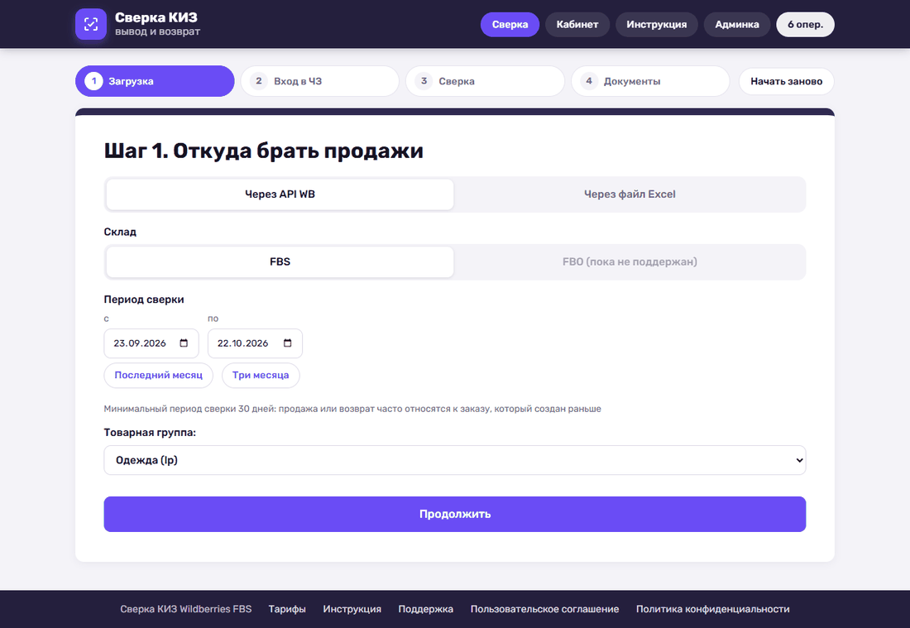
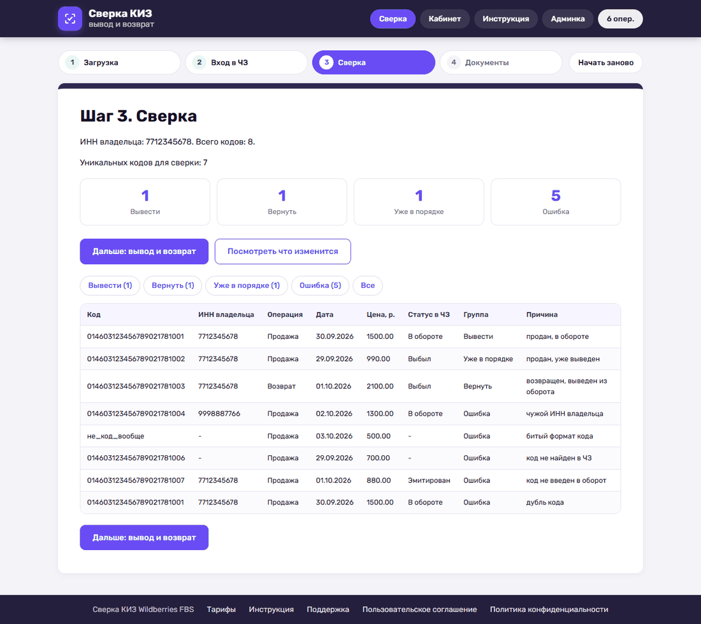
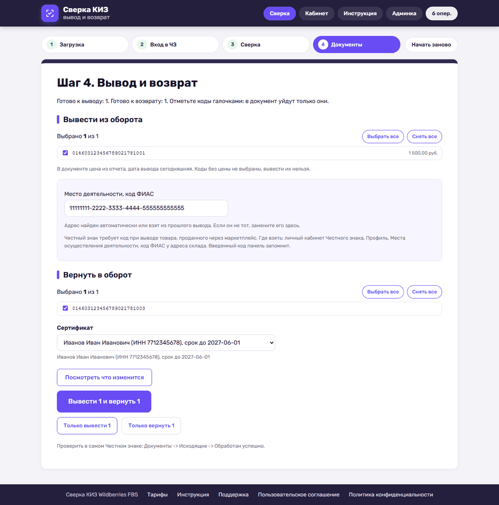
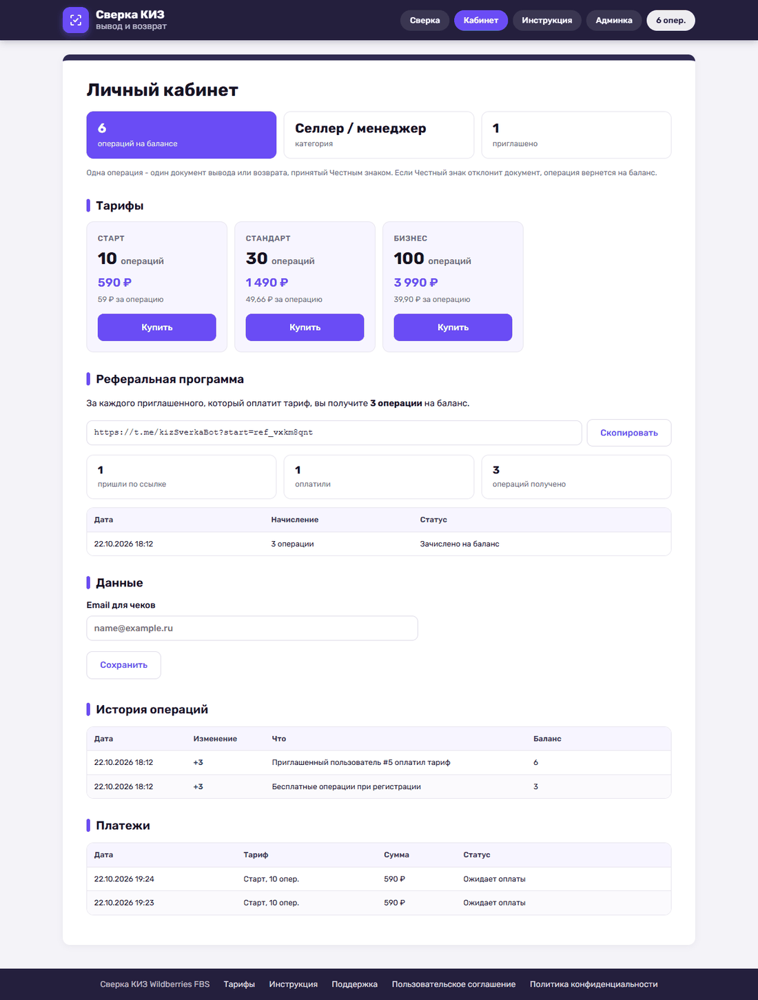
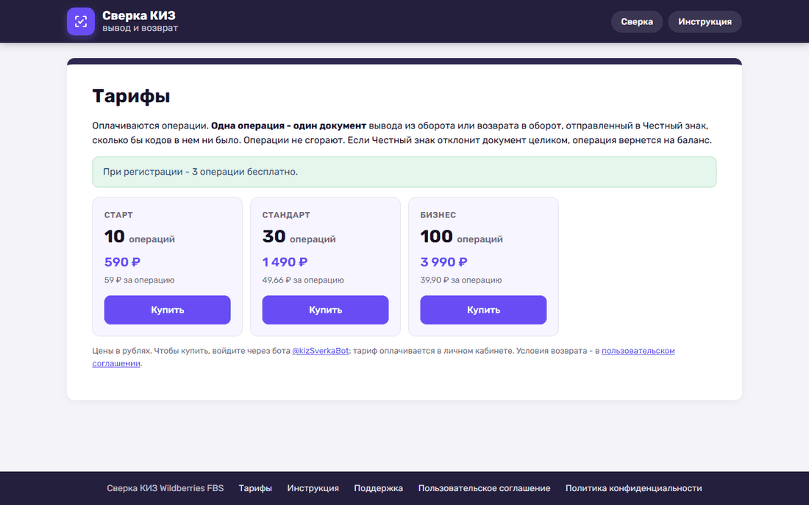
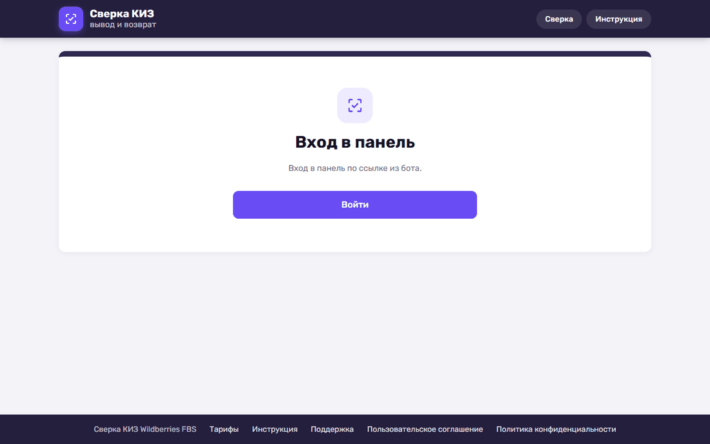
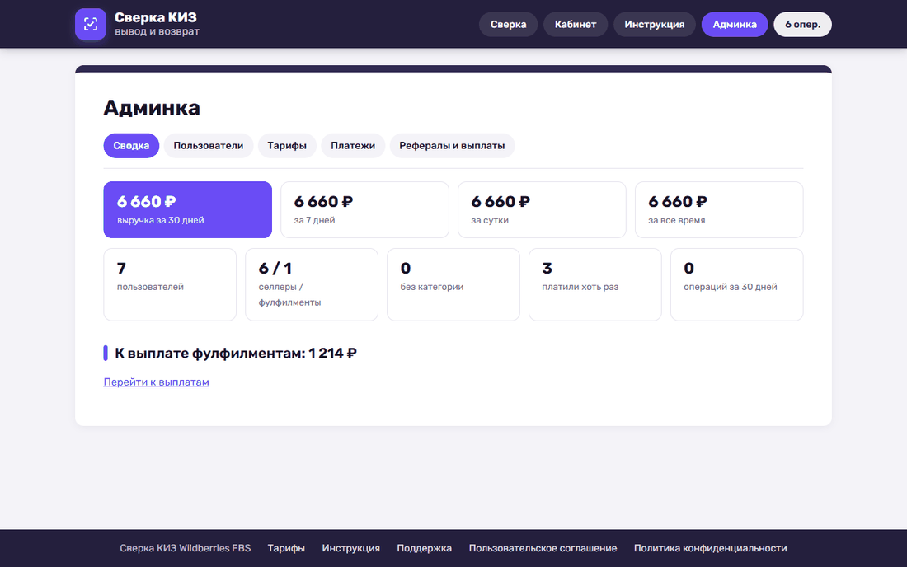
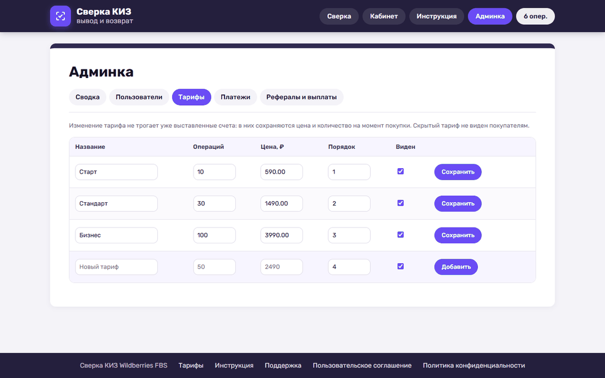
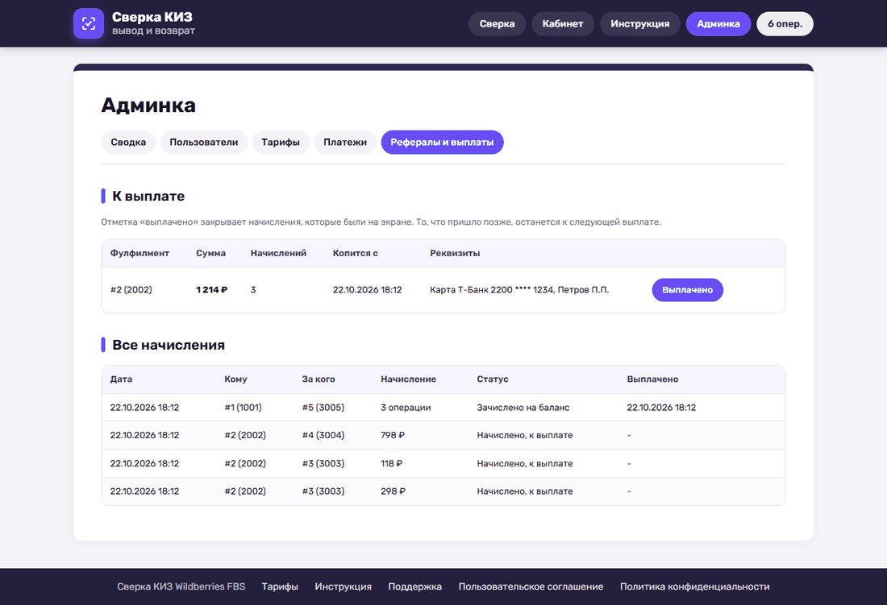
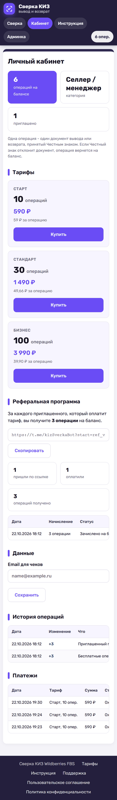

# Сверка КИЗ Wildberries FBS

Telegram-бот и веб-панель для продавцов Wildberries FBS: сверяют коды маркировки (КИЗ) с Честным знаком, выводят из оборота проданные и возвращают в оборот вернувшиеся. Документы пользователь подписывает своей электронной подписью в браузере, закрытый ключ не покидает его компьютер.

## Возможности

- **Сверка в 4 шага:** данные из WB по API или из файлов отчетов, вход в Честный знак подписью, таблица сверки, отправка документов вывода и возврата.
- **Баланс операций:** одна операция - один документ в Честном знаке, 3 операции бесплатно при регистрации, автоматический возврат операции при отказе ЧЗ.
- **Тарифы и оплата:** пакеты операций, тарифы меняются в админке, платежный провайдер подключается настройкой.
- **Реферальная программа:** селлеру операции за приглашенных, фулфилменту процент с оплат и учет выплат.
- **Админка:** выручка, пользователи и их баланс, тарифы, платежи, выплаты фулфилментам.
- **Бот:** меню одним сообщением, подключение токена WB, ссылка входа в панель, баланс, приглашения, помощь и документы.
- **Документы для платежной системы:** пользовательское соглашение, политика конфиденциальности, контакты поддержки, публичная страница тарифов.

## Скриншоты

| Шаг 1. Откуда брать продажи | Шаг 3. Сверка |
| --- | --- |
|  |  |

| Шаг 4. Вывод и возврат | Личный кабинет |
| --- | --- |
|  |  |

| Тарифы | Вход по ссылке из бота |
| --- | --- |
|  |  |

### Админка

| Сводка | Тарифы |
| --- | --- |
|  |  |

| Рефералы и выплаты | Телефон |
| --- | --- |
|  |  |

Скриншоты сняты в демо-режиме на тестовых данных.

## Требования

Python 3.12. Установите зависимости из `requirements.txt`. Скопируйте `.env.example` в `.env` и заполните значения для своего окружения. Для реальной работы задайте публичный HTTPS-адрес сайта и режим `real`. Переменная `CHZ_MODE` обязательна (`real` или `mock`): без нее панель и бот не запустятся. При адресе `https://` cookie сессии передается только по HTTPS.

Нужные секреты: токен своего Telegram-бота и новый ключ `FERNET_KEY`. Сгенерировать ключ можно командой `python -c "from cryptography.fernet import Fernet; print(Fernet.generate_key().decode())"`. Ключ шифрования нужно сохранить отдельно: он потребуется для расшифровки токенов, записанных в новой базе.

Основные настройки биллинга и документов в `.env`:

| Переменная | Что задает |
| --- | --- |
| `ADMIN_TG_IDS` | Telegram ID администраторов через запятую, только им видна админка |
| `BOT_USERNAME` | имя бота без @, для реферальных ссылок |
| `PAYMENT_PROVIDER` | `stub` - тестовая оплата, пусто - оплата выключена и кнопка показывает заглушку |
| `CHZ_FREE_OPS` | сколько операций дается при регистрации, по умолчанию 3 |
| `OPERATOR_NAME`, `OPERATOR_INN`, `OPERATOR_OGRN` | реквизиты для соглашения и политики |
| `SUPPORT_TG`, `SUPPORT_EMAIL`, `SUPPORT_HOURS` | контакты поддержки на сайте и в боте |

Бот и панель работают с одной базой: у обоих должны совпадать `CHZ_KIZ_DB` и `FERNET_KEY`.

## Запуск

Перед запуском перейдите в каталог проекта и загрузите переменные окружения из `.env` в текущую оболочку. В терминале выполните `set -a; source .env; set +a`. Затем запустите веб-панель командой `uvicorn chzkiz.web.main:app --host 127.0.0.1 --port 8140`, а бота в отдельной оболочке командами `set -a; source .env; set +a` и `python -m chzkiz.bot.main`.

Для постоянной работы команды запускают отдельными службами. Нужны домен с HTTPS и настроенный обратный прокси. Одновременно должен работать только один экземпляр бота с данным токеном.

## Тесты

`python -m pytest -q` из корня проекта. Тесты идут в демо-режиме и не обращаются к Честному знаку и Wildberries.

## Данные

База и отчеты создаются в каталогах, заданных `CHZ_KIZ_DB` и `CHZ_KIZ_REPORTS`. Токены Wildberries и Честного знака, добавленные пользователем, хранятся в базе в зашифрованном виде. Для нового сервера пользователи подключают свои ключи заново.

В репозитории нет `.env` с сервера, рабочей базы, резервных копий базы и личных данных из нее.
